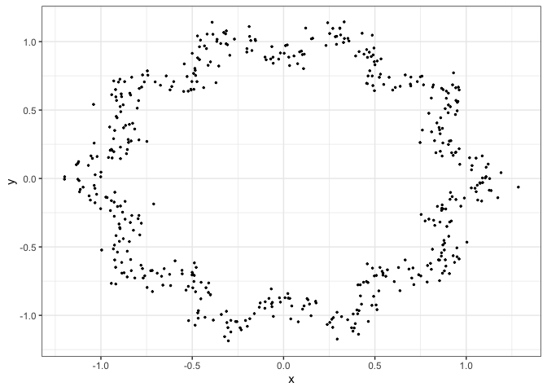
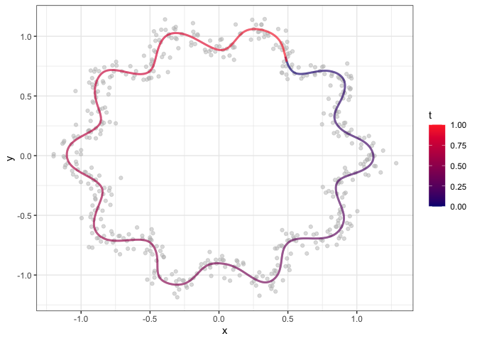
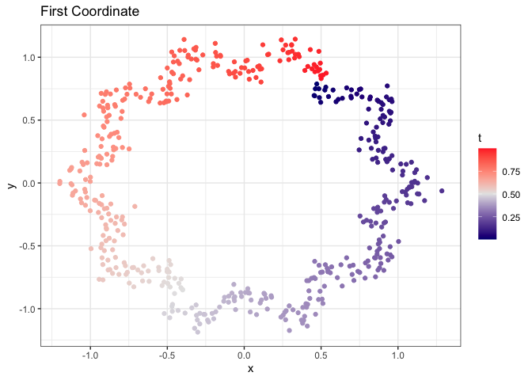
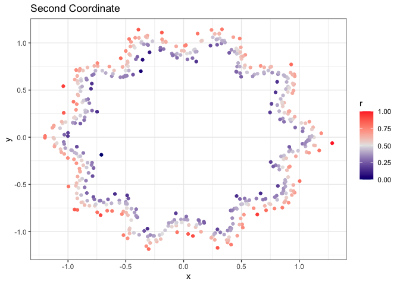
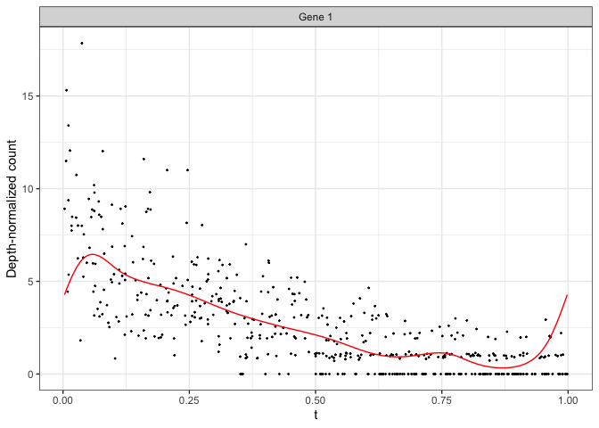
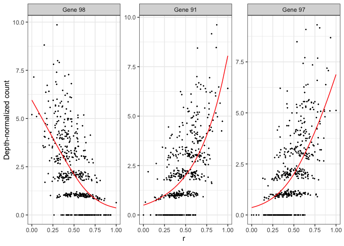

`MorphoGAM` is an R package that provides statistical tools for modeling
spatial gene expression along one-dimensional paths. The workflow has
two main steps:

1.  [`CurveFinder()`](https://phillipnicol.github.io/MorphoGAM/reference/CurveFinder.md)
    estimates a parametric curve that passes through the tissue
    coordinates and uses this to define a morphologically relevant
    coordinate system.
2.  [`MorphoGAM()`](https://phillipnicol.github.io/MorphoGAM/reference/MorphoGAM.md)
    fits generalized additive models (GAM) to find genes that vary along
    the morphologically relevant curves.

## Installation

From the R console:

``` R
devtools::install_github("phillipnicol/MorphoGAM")
```

## Quick example

The following simulated example illustrates the use of the two main
functions. First, create two-dimensional spatial coordinates:

``` R
set.seed(1)
library(MorphoGAM)
library(ggplot2)
library(dplyr)

theta <- seq(0, 2 * pi, length.out = 500)
r <- 1 + 0.12 * cos(10 * theta)

xy <- cbind(
  x = r * cos(theta) + rnorm(n = 500, sd = 0.05),
  y = r * sin(theta) + rnorm(n = 500, sd = 0.05)
)

data.frame(x=xy[,1], y=xy[,2]) |> ggplot(aes(x=x,y=y)) +
  geom_point(size=0.5) + theme_bw()
```



Because the tissue structure is implicitly one-dimensional, MorphoGAM
can be applied to extract *t* and *r* coordinates.

### Step 1: estimate morphologically relevant coordinates

[`CurveFinder()`](https://phillipnicol.github.io/MorphoGAM/reference/CurveFinder.md)
takes an *n* × 2 matrix or data frame of spatial coordinates and returns
the fitted curve together with the `t` and `r` coordinates.

``` R
curve_fit <- CurveFinder(
  xy,
  knn = "auto",
  loop = TRUE,
  prune.outlier = NULL
)
```

Because the tissue structure is better modeled with a closed curve, we
set `loop=TRUE` (setting `loop=FALSE` fits an open curve). `knn="auto"`
uses a model selection procedure to choose the best value of *k*.
Alternatively, the user can try several values of *k* and choose the one
that works the best.

The `curve_fit` model contains several results and plots:

``` R
curve_fit$curve.plot   # fitted curve plotted over coordinates
```



``` R
curve_fit$coordinate.plot  # position along the curve (t)
```



``` R
curve_fit$residuals.plot   # position orthogonal to the curve (r)
```



``` R
head(curve_fit$xyt) # Data frame containing t and r values

##          x             y         t         r       f1           f2
## 1 1.088677  0.0038651561 0.1592801 0.3899089 1.119955 -0.002127164
## 2 1.128143 -0.0007532266 0.1598151 0.5150007 1.120189 -0.005964799
## 3 1.074080 -0.0310553225 0.1648627 0.3557088 1.116111 -0.040833073
## 4 1.190511  0.0425426878 0.1547459 0.7225128 1.113303  0.030669298
## 5 1.120173  0.1052161516 0.1471814 0.6108764 1.085859  0.082398755
## 6 1.053796  0.1487169978 0.1370237 0.5826982 1.025142  0.134717329
```

Note that
[`CurveFinderInteractive()`](https://phillipnicol.github.io/MorphoGAM/reference/CurveFinderInteractive.md)
opens a shiny app that allows the user to hand-draw the curve.

### Step 2: model gene expression along the curve

[`MorphoGAM()`](https://phillipnicol.github.io/MorphoGAM/reference/MorphoGAM.md)
takes as input a counts matrix *n* × *p* counts matrix `Y`. Here, we
will generate a synthetic counts matrix `Y` with one gene with variation
in the *t* direction and 99 with variation in the *r* direction:

``` R
n_locations <- nrow(xy)
n_genes <- 100

Y <- matrix(0L, nrow = n_genes, ncol = n_locations)

# Gene 1 varies along t
eta_t <- log(2) - 3 * (curve_fit$xyt$t - 0.5)
Y[1, ] <- rpois(n_locations, lambda = exp(eta_t))

# Genes 2–100 vary along r, with different directions and effect sizes
r_effect <- rep(c(-1, 1), length.out = n_genes - 1) *
  seq(1, 3, length.out = n_genes - 1)

eta_r <- log(2) +
  outer(r_effect, curve_fit$xyt$r - 0.5)

Y[2:n_genes, ] <- matrix(
  rpois(length(eta_r), lambda = exp(eta_r)),
  nrow = n_genes - 1
)

rownames(Y) <- paste("Gene", seq_len(n_genes))
```

Now we can apply
[`MorphoGAM()`](https://phillipnicol.github.io/MorphoGAM/reference/MorphoGAM.md)
to fit a generalized additive model to each gene:

``` R
mgam <- MorphoGAM(
  Y,
  curve.fit = curve_fit,
  design = y ~ s(t, bs = "cc") + s(r, bs="cr"),
  min.count.per.gene = 10,
  return.fx = TRUE
)
```

Note that `design = y ~ s(t, bs = "cc") + s(r, bs="cr")` fits a model
including a smooth term for both the *t* and *r* coordinate. We use
`bs=cc` to fit a periodic function in the *t* direction. Common other
choices include:

``` R
# Variation only along the fitted curve
design <- y ~ s(t, bs = "cr")

# Variation only orthogonal to the fitted curve
design <- y ~ s(r, bs = "cr")

# Both directions
design <- y ~ s(t, bs = "cr") + s(r, bs = "cr")

# A non-periodic smooth for a closed curve, with orthogonal variation
design <- y ~ s(t, bs = "cr") + s(r, bs="cr")
```

MorphoGAM provides a results data frame that contains each gene as well
as some summaries of the estimated function.

- `peak.t` is the maximum height of the fitted function for *t* on the
  log scale.
- `range.t` is the range of the fitted function for *t* on the scale of
  the counts.
- `peak.r` and `range.r` are the equivalent for the fitted function in
  the *r* direction.
- `pv.t` and `pv.r` are the corresponding *p*-values for the null
  hypothesis that the function is 0.

For example, if we wanted to find a gene that varied the most in the *t*
direction, we could sort by genes with the largest `peak.t`:

``` R
mgam$results |> arrange(desc(peak.t)) |> head()

##             peak.t    range.t        pv.t     peak.r    range.r       pv.r
## Gene 1  1.49356467 5.20632298 0.000000000 0.01774403 0.04714376 0.07312087
## Gene 38 0.06456097 0.16319422 0.001556038 0.58659871 1.62485505 0.00000000
## Gene 24 0.03933418 0.08120660 0.018316422 0.55740478 1.28201140 0.00000000
## Gene 80 0.03422020 0.12947207 0.003950135 0.80710312 2.68462271 0.00000000
## Gene 97 0.02798697 0.06438621 0.009632596 1.24001522 4.81096313 0.00000000
## Gene 91 0.02058071 0.05162055 0.015191861 1.27260655 6.30931200 0.00000000
##         intercept
## Gene 1  -4.681794
## Gene 38 -4.618577
## Gene 24 -4.641936
## Gene 80 -4.600510
## Gene 97 -4.728496
## Gene 91 -4.690288
```

As expected, we identify gene 1, which was the one simulated to have
significant variation in the *t* direction.

We can visualize using MorphoGAM’s plotting function:

``` R
MorphoGAM::plotGAMestimates(Y, 
mgam_object=mgam,
genes=c("Gene 1"), curve_fit=curve_fit)
```



We can then repeat this for the top genes in the *r* direction,

``` R
r_sort <- mgam$results |> arrange(desc(peak.r)) |> rownames()

MorphoGAM::plotGAMestimates(Y, 
mgam_object=mgam,
type="r",
genes=r_sort[1:3], curve_fit=curve_fit)
```



## Additional examples

This website contains two additional examples of how MorphoGAM can be
used on real datasets, including how to find correlated groups of genes.
